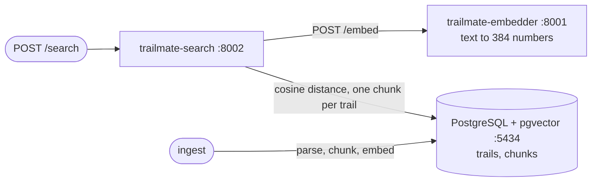

# TrailMate Phase 2: Applied Vector Search

**Walkthrough, demo script and results**

Author: Swikriti Mondal · Scope: Phase 2 of the IterForge training program (Python-only implementation)

---

## 1. What Phase 2 delivers

Phase 1 could only give generic hiking advice because it had no trail data. Phase 2 adds a way to find real
trails **by meaning**, so "quiet version of the popular waterfall hike" can match a trail whose text never says
"quiet version".

| Capability | How it is done |
|---|---|
| Embedding service | `trailmate-embedder` (FastAPI) wrapping `sentence-transformers/all-MiniLM-L6-v2`, 384 dimensions |
| Vector storage | PostgreSQL 16 with the pgvector extension (0.8.7), in Docker |
| Search service | `trailmate-search` (FastAPI): embeds the query, finds the closest chunks, returns one best chunk per trail |
| Data pipeline | Parse the 16 trail files, chunk by section, embed, store. Idempotent, one transaction |
| Grounded facts | Difficulty, distance, elevation, best-for and dogs policy parsed into database columns and returned as `facts` |
| Validation | `eval/check_queries.py` runs the 10 provided test queries plus the near-duplicate pair queries |
| Migrations | Alembic, with its own version table so later services can share the database |

**Scope note:** the Phase 2 PDF also describes rebuilding the search service in Java (Spring Boot, Feign) with
Python-vs-Java notes. That part was **intentionally not done**; the project is Python-only by decision.

## 2. Architecture



Ports: embedder 8001, search 8002, database 5434 (BookVerse uses 5433).

**Request flow for one search**
1. The client sends `{"query": "...", "top_k": 3}` to the search service.
2. The search service asks the embedder to turn the query into 384 numbers.
3. PostgreSQL compares that vector with every chunk's vector (`<=>`, cosine distance).
4. `DISTINCT ON (trail_id)` keeps only the closest chunk of each trail, so results are distinct trails.
5. The service returns the top trails, each with its score, the matching text and its facts.

## 3. Where things live

| File | Role | Spring Boot analogy |
|---|---|---|
| `services/embedder/src/trailmate_embedder/main.py` | `/embed` and `/health`; model loaded once at startup | a small `@RestController` |
| `services/search/.../main.py` | `/search`, `/trails`, `/trails/{slug}`, `/health` | `@RestController` |
| `services/search/.../parsing.py` | Markdown to facts and chunks | a parser / mapper class |
| `services/search/.../ingest.py` | Load the data: parse, chunk, embed, store | a batch job / `CommandLineRunner` |
| `services/search/.../models.py` | `trails` and `chunks` tables | JPA `@Entity` classes |
| `services/search/.../embedder_client.py` | Calls the embedder behind a `Protocol` | a hand-written Feign client behind an interface |
| `services/search/alembic/` | Schema migration `0001` | Flyway / Liquibase |
| `eval/check_queries.py`, `data/queries.json` | Validation against the test queries | an integration test runner |
| `scripts/search.py` | Optional terminal search tool | none (a convenience script) |

## 4. API contract

`POST /embed` on :8001: `{"texts": ["easy waterfall hike"]}` returns `{"model", "dimensions": 384, "embeddings": [[...]]}`.
Between 1 and 64 texts per call, each up to 5000 characters. Vectors are normalised.

`POST /search` on :8002: `{"query": "...", "top_k": 3, "strategy": "section"}` (`top_k` 1 to 10). Example response
(real output, trimmed):

```json
{
  "query": "quiet version of the popular waterfall hike",
  "strategy": "section",
  "results": [
    {
      "slug": "cascade-falls-extension",
      "name": "Cascade Falls Extension",
      "score": 0.5354,
      "matched_section": "Details",
      "excerpt": "- Difficulty: Easy-Moderate\n- Distance: 5.5 km ...",
      "facts": {
        "difficulty": "Easy-Moderate", "distance_km": 5.5, "elevation_gain_m": 180,
        "best_for": ["Waterfall views without the crowds", "slightly longer outings"],
        "dogs_allowed": "Yes, on leash"
      }
    }
  ],
  "timing_ms": {"embed": 295.8, "search": 43.9, "total": 339.7}
}
```

Other endpoints: `GET /trails`, `GET /trails/{slug}`, `GET /health` (reports trail and chunk counts).
Errors: an unreachable embedder returns `503` with `{"error": {"status": 503, "message": ...}}`.

## 5. Chunking: what, why, trade-offs

**Strategy "section":** one chunk per `##` heading of each trail file. 16 trails become **51 chunks**
(15 trails with 3 sections each, plus Thunder Gorge Trail with 6).

- **Prefix:** every chunk is embedded as `"{Trail Name} - {Section}: {text}"`. Without the trail name, a chunk that
  says "the same creekside path as the standard route" would look identical for the two Cascade Falls trails.
- **Tagline:** the one-line italic summary under each title is added to the Overview chunk.
- **What is stored:** `text` (the original, shown as evidence) and `embedded_text` (exactly what was embedded).
- **Facts are not left to the search at all.** The Details bullets are parsed into real columns, so numbers come from
  the database, never from a model.
- **The `strategy` column** lets other chunking strategies sit in the same table for comparison later.

| Choice | Why | Trade-off |
|---|---|---|
| Split by section | The files are already organised by section, so chunks match how the author grouped ideas | The short Details chunk is just bullet text, so it can match loosely (it won the match for several queries) |
| Name prefix on every chunk | Keeps near-duplicate trails apart | A little repeated text in every chunk |
| One best chunk per trail | Results are distinct trails, not three fragments of one | Needs an exact scan (see below) |

**No ANN index (HNSW).** At 51 chunks an exact scan is instant, and the one-chunk-per-trail rule needs the exact
scan anyway. At a much larger scale you would add an index and de-duplicate afterwards.

## 6. Demo script (about 8 minutes)

### Before starting
```text
docker compose up -d db                  # wait for "healthy" in: docker compose ps
Terminal A:  cd services\embedder   then   uv run uvicorn trailmate_embedder.main:app --port 8001
Terminal B:  cd services\search     then   uv run uvicorn trailmate_search.main:app --port 8002
Terminal C:  from the Trailmate folder, used for the commands below
```
If the data is not loaded yet: `cd services\search`, then `uv run alembic upgrade head`, then
`uv run python -m trailmate_search.ingest` (expect `Ingested 16 trails as 51 chunks`).

### Step 1: the idea (1 min)
Show the architecture diagram.
> *"Keyword search fails when the question and the document use different words. Here every text becomes 384
> numbers, similar meanings get similar numbers, and search is finding the nearest ones."*

### Step 2: the embedder (1 min)
Open `http://localhost:8001/docs`, run **POST /embed** with `{"texts": ["easy waterfall hike"]}`, and show
`http://localhost:8001/health` (`"dimensions": 384`).
> *"One job, no database. The model is small enough to run on a CPU-only laptop."*

### Step 3: data to facts (1 min)
Open one file in `data/trails/`, then `http://localhost:8002/trails/cascade-falls-extension`.
> *"The Details bullets became real columns. The app states these numbers from the database, never from a model."*

### Step 4: search by meaning (1 min)
```text
python scripts/search.py "quiet version of the popular waterfall hike"
```
Point at: the Extension first, the matched text "Waterfall views without the crowds", and the facts.

### Step 5: the near-duplicate pair that works (1 min)
```text
python scripts/search.py "flat easy dog-friendly walk with some history or old ruins"
```
Expected from the recorded run: Old Mill Loop 0.598 against Willow Creek Wander 0.466, a clear margin.
> *"Both trails are flat, easy and dog-friendly. Only Old Mill mentions the mill ruins, and the search found it."*

### Step 6: honest weaknesses (1.5 min)
```text
python scripts/search.py "A waterfall hike but not too crowded"
python scripts/search.py "Looking for a hard scramble with a waterfall"
```
Expected from the recorded run: Cascade Falls Loop (0.564) above the Extension (0.551), and an *easy* trail
ranked first for "hard scramble".
> *"It finds topics well and misses constraints like 'hard' and 'not crowded'. These are my targets for the next step."*

### Step 7: the measured result (1 min)
```text
python eval/check_queries.py
```
Expected: `Passed 10/12`, `Near-duplicate pairs: 2/3`, and the rank-1 / top-2 / top-3 line.

### Step 8: tests (30 s)
```text
cd services\embedder    then   uv run pytest -q
cd services\search      then   uv run pytest -q          (needs the db container)
```

---

## 7. Results

### Environment
CPU only (Intel Iris Xe graphics), 31.7 GB RAM. Embedder model `all-MiniLM-L6-v2`, PostgreSQL 16 with pgvector 0.8.7.
The model downloaded from Hugging Face on first start; after that it runs locally.

### Ingestion
`Ingested 16 trails as 51 chunks (section strategy).` Running it again gives the same counts (replaced, not doubled).

### Validation against the provided test queries
Rules, taken from the provided test file ("the top 1-2 results should be sensible"): a normal query passes if an
expected trail is in the **top 2**; a pair query passes only if the right trail ranks **above** its near-duplicate.
Scores are cosine similarity.

| # | Query | First expected trail | Result | Note |
|---|---|---|---|---|
| 1 | easy trail near water for tomorrow morning | rank 1 (Hidden Spring, 0.607) | PASS | |
| 2 | short and dog-friendly, totally flat | rank 2 (Old Mill, 0.389) | PASS | a non-expected trail was first, 0.399 |
| 3 | hard scramble with a waterfall | rank 3 (Thunder Gorge, 0.436) | **FAIL** | an easy trail (Cascade Falls Loop) ranked first |
| 4 | best sunset viewpoint hike | rank 1 (Sunset Bluff, 0.649) | PASS | |
| 5 | family hike with wildflowers, not too long | rank 1 (Meadowbrook, 0.547) | PASS | |
| 6 | alpine trail where I might see snow | rank 2 (Timberline Pass, 0.531) | PASS | three trails tied at 0.531 |
| 7 | coastal hike with some exposure | rank 1 (Rocky Point, 0.580) | PASS | |
| 8 | quiet forest trail with a creek crossing | rank 1 (Fern Valley, 0.655) | PASS | Willow Creek close behind, 0.642 |
| 9 | waterfall hike but not too crowded | rank 2 (Extension, 0.551) | **FAIL** | must outrank the Loop (0.564) and does not |
| 10 | steep climb with a big payoff view, exposure is fine | rank 1 (Blackrock Summit, 0.504) | PASS | |
| 11 | quiet version of the popular waterfall hike | rank 1 (Extension, 0.535) | PASS | beats the Loop by only 0.001 |
| 12 | flat easy dog-friendly walk with history or old ruins | rank 1 (Old Mill, 0.598) | PASS | clear margin over Willow Creek, 0.466 |

**Summary:** passed **10/12**; near-duplicate pairs **2/3**; first expected trail at rank 1 in **8/12**, within the
top 2 in **11/12**, within the top 3 in **12/12**. Latency for embed plus search in the checker run: mean 61 ms, max 284 ms.
A single query through the terminal tool took about 290 ms to embed and 10 to 44 ms to search.

### How the checker's rules were corrected
The first version of the checker reported 12/12. It used a top-3 pass rule and did not encode query #9's "over the
Loop" requirement from the provided test file. After comparing it with that file, the rules were corrected to the ones above,
which gives the 10/12 baseline. The saved output is in `docs/stage2a-baseline.txt`.

### Reading the results
- Strong on **topics** (sunset, coastal, forest creek) and on the history query that separates Old Mill from Willow Creek.
- Weak on **constraints** such as "hard" (#3) and "not crowded" (#9). *Hypothesis, not yet tested:* the embedding captures
  what a trail is about more than how hard or how busy it is. Difficulty appears in the data as literal text
  (`Difficulty: Hard`), which keyword matching would catch; combining keyword and vector search is the natural next experiment.
- The near-duplicate pair margins are thin for the Cascade pair (0.001 on #11, reversed on #9).
- **12 queries over 16 documents is a small sample.** One ranking change moves the score a lot, so treat the numbers
  as indicative, not final.

## 8. Design decisions and trade-offs

| Decision | Why | Trade-off |
|---|---|---|
| Small local model (`all-MiniLM-L6-v2`) | The assignment asks for a small local model; it is fast on a CPU laptop | Not compared with other models on this data. The model was my choice; the PDF names only the library |
| Embedder as its own service | One job, easy to swap the model, heavy libraries stay in one place | One more service to run |
| Embedding runs in a worker thread | Encoding is CPU-bound; this keeps the server responsive | Slight complexity |
| `Embedder` behind a Protocol | Tests use a fake, so they need no model download | One extra abstraction |
| Facts parsed into columns | The app can state numbers from the database, never from a model | Needs the Details format to stay consistent (parsing fails loudly if not) |
| `DISTINCT ON (trail_id)` | One result per trail | Exact scan, no ANN index |
| Ingest embeds first, then writes in one transaction | An embedder failure leaves the database untouched | Whole dataset in memory (fine at this size) |
| Idempotent ingest | Safe to re-run after changing the chunking | Chunks are replaced, not versioned |
| Own Alembic version table (`alembic_version_search`) | Other services will share the database later | None significant |
| Vectors sent to Postgres as text | Works with SQLAlchemy's pgvector type without extra driver setup (a driver codec I tried first clashed with it) | None significant |

## 9. Known limitations

- Fails two of the 12 checks (#3 and #9), and the Cascade pair margin is thin.
- Single embedding model, no comparison with others.
- Only the section chunking strategy has been tried; other strategies were not compared.
- No keyword search, no reranking, and no Precision@K / Recall@K / MRR measurement yet. These are planned
  extensions that were deferred in favour of moving on to Phase 3.
- Small data set (16 trails, 12 queries). The data has no location field, so "near Mumbai" cannot be answered from it.
- The Java reimplementation and Python-vs-Java notes in the PDF were not done (Python-only scope).

## 10. Definition of Done check

| Requirement | Status | Evidence |
|---|---|---|
| `trailmate-embedder` returns real vectors, no external API | Done | `/health` shows 384 dimensions; the model downloads once, then runs locally |
| `trailmate-search` returns real, similarity-ranked results | Done | Section 4 example; scores in section 7 |
| Ingestion and chunking approach documented and defensible | Done | Section 5 |
| Retrieval validated against the provided test queries, including the near-duplicate pairs | Done | Section 7 and `docs/stage2a-baseline.txt`: 10/12, pairs 2/3 |
| Adjust chunking or retrieval if results do not hold up, and note what changed | Partly | The checker's rules were corrected (section 7); retrieval changes were deferred. The two failures are the targets |
| Java search service with the same contract | Not done | Out of scope (Python-only) |
| Written notes comparing Python and Java | Not done | Out of scope (Python-only) |

## 11. Likely questions

**Why chunk by section?** The files are already organised that way, so each chunk is one idea. The trade-off is that the
short Details chunk is only bullet text.

**Why put the trail name in front of every chunk?** So a chunk's vector stays tied to its trail. It is what keeps the two
Cascade Falls trails, which share their first two kilometres, distinguishable.

**What is the score?** Cosine similarity between the query vector and the chunk vector: higher means closer in meaning.
Scores here sit between about 0.4 and 0.65 and are only meaningful relative to each other.

**Why are the scores so close together?** Short queries against short chunks, and a small model, give modest separation.
That is why a 0.001 margin (query #11) should not be trusted as a confident win.

**Why does query #3 fail?** The model matched "waterfall" and gave less weight to "hard scramble". That is an observation
from one query; the keyword-plus-vector idea is a hypothesis to test, not a result.

**Why no vector index?** At 51 chunks an exact scan is instant, and the one-chunk-per-trail rule needs it. At scale you
would add an index and de-duplicate afterwards.

**Why return facts from the database?** So numbers in an answer can never be invented. The model may write the explanation
but not the facts.

**What if the embedder is down?** The search service returns a clean 503 instead of crashing. Ingestion refuses to write
anything if it cannot embed everything.

**Why was your first score 12/12 and now 10/12?** The first checker was too lenient: it used the top 3 and missed the
"over the Loop" rule in query #9. I corrected it against the provided test file and recorded the honest baseline.

**What would you do next?** Combine keyword and vector search, compare chunking strategies, measure Precision@K,
Recall@K and MRR on a larger query set, then try a reranker, scoring each change against this 10/12 baseline.

---

## 12. Reproduce it

```text
docker compose up -d db

# embedder (first `uv sync` is large because of PyTorch; first start downloads a ~90 MB model)
cd services\embedder
uv sync
uv run uvicorn trailmate_embedder.main:app --port 8001

# search
cd services\search
uv sync
uv run alembic upgrade head
uv run python -m trailmate_search.ingest        # Ingested 16 trails as 51 chunks
uv run uvicorn trailmate_search.main:app --port 8002

# validate (from the Trailmate folder)
python eval/check_queries.py
```
