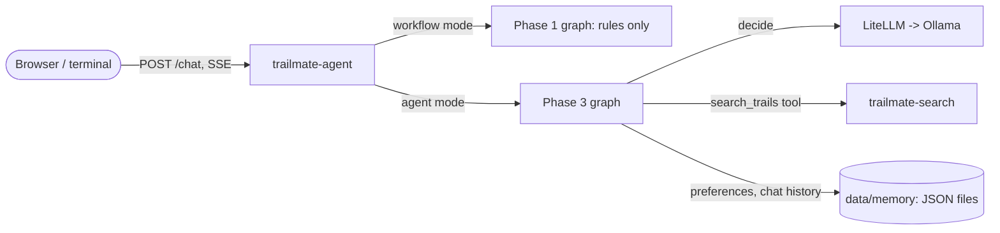

# TrailMate Phase 3: Agentic Systems Design

**Walkthrough, demo script and results**

Author: Swikriti Mondal · Scope: Phase 3 of the IterForge training program

---

## 1. What Phase 3 delivers

Phase 1 routed messages with fixed rules and had no real trail data. Phase 3 adds a second mode, **agent**, where
the model decides what to search for and the search tool (Phase 2) supplies real facts. Both modes stay available
(`--mode workflow` / `--mode agent`), so the same message can be compared across phases.

| Capability | Status |
|---|---|
| Agent decides whether to search, using a real tool call | Done |
| Rules handle the obvious cases (greetings, thanks, refusals) so the model is never asked | Done |
| One clarifying question for a vague request, decided by code | Done |
| Recommendations built from retrieved facts, not written by the model | Done (default); model-written kept as opt-in |
| Session memory ("show me more", "the second one", "something harder") | Done |
| Long-term memory, learned automatically per user, plus saved chat history | Done |
| Difficulty and length filters read from plain words | Done |
| Basic chat UI (streaming, trail cards, history, memory panel) | Done |
| Live demo, written retro | This document |

## 2. Architecture



**The agent graph:**
```
input_guard -> triage --chat/reject--> templated reply
                 |-- memory command (remember/forget/recall/start over) --> memory_cmd
                 |-- "the second one" --> show_details     |-- "show me more" --> prepare_more --+
                 |-- too vague (nothing to go on) --> ONE clarifying question                    |
                 '-- otherwise --> decide (MODEL: what to search for) --> run_search <------------+
                        filters by difficulty/length, drops place names, loosens a filter          |
                        that matches nothing (oldest first) before refusing                        |
                        tied? -> compare both (code)    else -> explanation built by code           |
                 every reply -> output_guard (grounding check) -> END                                
```

**Who decides what.** Code decides: the obvious cases, whether a request is too vague, difficulty/length/features
read from the words used, whether two results are tied, whether a match is too weak to recommend, the facts shown,
and the check that a reply invents nothing. The model decides one thing: what to search for, and whether to search
at all. This split came directly from measuring the local models (section 4), not from a preference for rules.

## 3. Demo script (about 10 minutes)

### Before starting
Everything from Phase 2, plus:
```text
python scripts/start_litellm.py                          # terminal, leave running
cd services\agent  &&  uv run uvicorn trailmate_agent.main:app
```
Open **http://localhost:8000/**.

### Step 1: compare the two phases (1 min)
Mode = Workflow, ask "an easy waterfall hike" → generic text, no trail data.
Mode = Agent, same question → real trails, with facts from the database.
> *"Phase 1 could only talk about hiking in general. Phase 3 can actually look."*

### Step 2: the agent decides (1 min)
Ask "somewhere to clear my head" — a phrase Phase 1's keyword router missed entirely.
> *"There's no trail keyword here. The model itself decided this was worth searching."*

### Step 3: it asks instead of guessing (1 min)
Ask "Suggest a good trek" → one clarifying question, no search.
> *"Too vague to search usefully, so it asks — that's a rule, not the model's judgment, because in testing the
> model never asked on its own."*

### Step 4: grounded, no invented facts (1.5 min)
Ask "I want an easy waterfall hike" → cards with real facts; point at "Why it fits" / "Not matched".
> *"These sentences are built from the database. The model never writes a distance or a feature claim."*

### Step 5: filters from plain words (1.5 min)
Ask "short and challenging" → an honest note that no such trail exists in this data, then the closest matches.
Ask "something short" right after → the old difficulty is dropped, not the new word.
> *"Difficulty and length are real filters now, derived from the data's own range, not guessed."*

### Step 6: memory (2 min)
New chat → "another easy waterfall hike" twice → the memory box learns "easy trails, waterfall" without being
told to remember. New chat → "Suggest a good trek" → it already knows. Click a chat in the sidebar to reopen it.
> *"It learns the way a person would notice a pattern, and you can see and erase everything it knows."*

### Step 7: it doesn't overreach (1 min)
Ask "hard scramble with a waterfall" → the trail that doesn't mention a waterfall is marked "Not matched: waterfall".
Ask "Any easy waterfall hikes near Mumbai?" → a note that the data has no locations.

### Step 8: tests (30 s)
```text
cd services\agent  &&  uv run pytest -q
```

---

## 4. Pre-build measurement: can the local models call a tool?

Before writing the agent, `scripts/tool_call_check.py` measured whether `qwen2.5:3b` (`fast`) and the `smart` tier
could decide correctly when to call a `search_trails` tool. 10 prompts, temperature 0, one run each.

| | `fast` | `smart` |
|---|---|---|
| Right decision (8 scored prompts) | 6/8 | 5/8 |
| Valid tool-call arguments | 9/9 | 10/10 |
| Tool call written as plain text instead | 0 | 0 |
| Held back on greetings/thanks (3 prompts) | 1/3 | 0/3 |

**Finding:** native tool calling works on this hardware, but both models over-called it on "Hello!" and "Thanks",
and neither asked a clarifying question for a vague request. This is the evidence behind the hybrid design in
section 2: rules for the obvious and the vague, the model for the rest.

## 5. First real-model test: what went wrong, and the fixes

Five real queries were run against the first version of the agent (model-written recommendations, no filters, no
cutoff). Three were good; two exposed real defects:

| Finding | Evidence | Fix |
|---|---|---|
| Invented a location | the reply said a trail was "near Mumbai"; no file in the data mentions any location | Recommendations are built by code from retrieved facts. Place names are also stripped from the search query (it measurably lowered the top score: 0.640 → 0.529 with "near Mumbai" added) |
| Credited a trail with a feature it lacks | "Blackrock Summit... fitting the request for a hard scramble with a waterfall" — Blackrock's text never mentions a waterfall | The search service reports which requested words each trail's text actually contains (`terms_found`); the reply only credits what is really there |
| Wrong difficulty ranked first | an Easy trail ranked 1st for "hard scramble"; a Hard trail ranked 2nd for "easy" | Difficulty is read from the request and applied as a database filter, not left to the embedding |
| A weak match (score 0.144) got a confident answer | "somewhere to clear my head" | A relevance cutoff (calibrated in section 6): below it, the agent asks instead of recommending |
| Slow | the model-written answer took 26–35 s on top of the decision call | No second model call: the recommendation is written by code, cutting the recommend path to about 4–5 s warm |

Later, live use via the UI surfaced three more real bugs, each fixed and covered by tests:

| Found in use | Fix |
|---|---|
| "okay show some easy ones" / "short and challenging" were refused outright | A request that is only filter words (difficulty, length) is never refused for a low score — the filter *is* the request |
| A difficulty dropped for lack of a match (e.g. "short" after "hard") kept reappearing on the next turn | The long-term store was reloaded fresh every turn and silently reapplied it; a dropped filter is now suppressed for the rest of the session until asked for again |
| "some peaceful ones" was refused outright | "Quiet"/"peaceful" is not a data field and can never score well; such requests are now also exempt from the cutoff |

## 6. Hybrid search: measured, not adopted

Your Phase 2 baseline failed query #3 ("hard scramble with a waterfall") and #9 ("not too crowded"). Keyword search
(PostgreSQL full-text) fused with vector search by Reciprocal Rank Fusion was built and measured against the same
12 queries (`docs/hybrid-comparison.txt`):

| | vector | keyword | hybrid |
|---|---|---|---|
| Passed | 10/12 | 10/12 | 10/12 |
| Near-duplicate pairs | **2/3** | 1/3 | 1/3 |
| Within top 2 | **11/12** | 10/12 | 10/12 |

Hybrid fixed #3 but made the near-duplicate pair #11 worse. No mode is clearly better overall, so **the default
stayed `vector`**. #3 is handled instead by the difficulty filter (section 5). #9 fails in every mode: both Cascade
trails mention crowds in their text, so keyword matching cannot separate "not crowded" from "popular" — a limitation
of the data, not of the search method.

## 7. Calibrating the relevance cutoff

`eval/check_cutoff.py` scored the 12 real questions and 8 out-of-scope questions (`docs/cutoff-calibration.txt`).
Real questions scored 0.399–0.655; out-of-scope ones 0.151–0.453, with some overlap. **Chosen: 0.35.** It refuses
none of the real questions (a 0.05 margin below the lowest real score) and 6 of the 8 out-of-scope ones. Two
out-of-scope questions still get through ("best restaurant near the trailhead", "history of the Appalachian
Trail") — no score cutoff can separate every case, and the code-built reply stays honest about weak matches either way.

## 8. Memory

| | Short-term | Long-term |
|---|---|---|
| What | the conversation: filters and features so far, which trails were shown | what the agent has learned or been told |
| How | automatic | automatic: every search request is counted; asked for at least twice means a usual preference; "I love waterfalls" / "I always prefer easy trails" counts at once |
| Where | one LangGraph thread per user+session (RAM; restored from the saved chat after a restart) | `data/memory/preferences.json`, one entry per name |
| Control | `start over` | "what do you know about me", "forget my preferences", the sidebar's Forget button, the **Remember me** switch |

Chat history is saved per name (`data/memory/chats/<name>/<chat>.json`) and reopenable from the sidebar, including
after a server restart. Neither store is authenticated — anyone who knows a name can read that name's data. Fine
for a local training project, not for production.

## 9. Testing

255 unit/integration tests accumulated through Stage 3A, then grew to **319 agent, 52 search, 9 embedder** tests
as memory, history, filters and the real-model fixes were added. Deliberate breakages (disabling the grounding
check, the tie rule, the vague-request rule, the difficulty filter, the dismissed-preference suppression, and
others) were used throughout to confirm the tests actually fail when behaviour breaks — not just that they pass.
The chat UI's real JavaScript was also run against the real server in a simulated browser (61 checks: streaming,
cards, history, memory, Remember me, refresh-reopens-chat, error handling), with the same mutation-testing approach.

## 10. Known limitations

- Query #9 ("not too crowded") fails in every search mode — a data limitation, not a bug.
- The relevance cutoff (0.35) and the length thresholds (short ≤ 4 km, long ≥ 8 km) are calibrated from this small
  dataset; they would need rechecking on a larger one.
- "Easy" matches only trails rated exactly Easy, not Easy-Moderate.
- Cold start costs about 20 s on the first request after idle; warm recommend turns take about 4–5 s.
- Neither memory store is authenticated.
- In this data, length and difficulty correlate (short trails are Easy, long trails are Hard), so "short and
  challenging" has no real answer — again the data, not the agent.

## 11. Definition of Done check

| Requirement | Status |
|---|---|
| The agent node makes real decisions using the model, not fixed rules | Done — the model decides what to search for and whether to search at all |
| The Phase 2 search service is wired in as a genuine tool, called only when needed | Done — rules keep the model from being asked on greetings/thanks; measured in section 4 |
| At least one ambiguity-handling strategy implemented and demonstrated | Done — the clarifying question (section 2, demo step 3) and the tie-comparison path |
| A working chat UI sends messages and renders streamed responses | Done — see `services/agent/src/trailmate_agent/static/index.html` |
| A live demo covers a direct question, an ambiguous one, and one requiring a tool call | Covered in the demo script, section 3 |
| A short written retro reflects on the agent's decision quality | This document, sections 5–7 |

## 12. Likely questions

**Why doesn't the model write the final answer?** It did, at first, and invented a location and a feature a trail
didn't have (section 5). Code can't invent facts it wasn't given.

**Why not let the model decide everything, including when to ask a question?** Measured in section 4: it never
asked a clarifying question on its own, and over-called the tool on plain greetings.

**Why keep the old Phase 1 workflow mode?** To compare rule-based and agent-based behaviour side by side, and
because your training document asks not to throw away determinism entirely.

**Why didn't hybrid search become the default?** Measured, not assumed: it helped one query and hurt another, with
only 12 queries to judge by (section 6).

**How does "short" and "long" know where to draw the line?** From the data itself: every Easy trail in this dataset
is 4 km or under, every Hard trail is 8.2 km or over.

**Is the memory private?** No authentication. Anyone who knows a user's name can read what's remembered and saved.
Acceptable for a local training exercise; flagged as a limitation.

**What would you do next?** Phase 4: Langfuse tracing of the agent's decisions, structured logging with request
IDs, and a dashboard — so the cold-start and decide-call latency can be measured properly instead of estimated.

---

## 13. Reproduce it

```text
docker compose up -d db
cd services\embedder  &&  uv run uvicorn trailmate_embedder.main:app --port 8001
cd services\search    &&  uv run alembic upgrade head   &&  uv run uvicorn trailmate_search.main:app --port 8002
python scripts/start_litellm.py
cd services\agent     &&  uv run uvicorn trailmate_agent.main:app

# measure, don't assume
python eval/check_queries.py --compare
python eval/check_cutoff.py
python scripts/tool_call_check.py --models fast,smart

# tests
cd services\agent && uv run pytest -q   # 319 passed
cd services\search && uv run pytest -q  # 52 passed
```